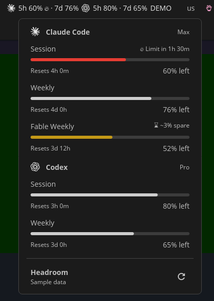

# Headroom for COSMIC

Claude Code and Codex quotas in the COSMIC top panel, with reset countdowns and forecasts.

This is [Headroom](https://github.com/steveclarke/gnome-headroom), Steve Clarke's GNOME Shell
extension, as a native applet for the COSMIC desktop, where GNOME extensions do not load. The
numbers, the wording and the usage readers are Headroom's own, unchanged; only the drawing is new.
Built and tested on **Pop!_OS 24.04, COSMIC 1.10.0**.



## Install

On Pop!_OS 24.04, everything it needs comes from one line:

```sh
sudo apt install git rustup build-essential pkg-config libxkbcommon-dev libwayland-dev gjs python3
```

Then:

```sh
git clone https://github.com/alexjpower74-create/cosmic-headroom.git
cd cosmic-headroom
./install.sh --panel
```

That builds everything, installs it for your user only (nothing needs sudo) and adds Headroom as
the first applet on the right of the top panel. The first build downloads the Rust toolchain named
in `applet/rust-toolchain.toml` and takes a few minutes. If Headroom does not show up in the panel
straight away, log out and back in.

Run `./install.sh` again after a change to rebuild and restart it. `./install.sh --remove` takes it
out again and leaves your settings alone.

As with the GNOME extension, you only have to be logged in to Claude Code and/or Codex on this
computer. There is nothing to sign in to here.

## Use

- The panel shows each provider's mark and its numbers, for example `79%`, or `5h 96% · 7d 79%`
  with both windows turned on. `!` marks an old reading and a flame a window that is on course to
  run out.
- Click it for every quota window: a meter, the reset countdown and the forecast.
- The round arrow asks for an update now (at most one every 20 seconds). Otherwise it updates
  every five minutes.

## Settings

There is no settings window yet. Without a settings file it starts the way the GNOME extension
does: Claude Code and Codex, the weekly window in the panel, shown as what is left. To change
that, write a small file, `~/.config/headroom/cosmic.json`; it is read again whenever it changes.
For example, Claude only, with the 5-hour window beside the weekly one:

```json
{
  "providers": ["claude"],
  "barWindows": ["session", "weekly"],
  "display": {"claude": "remaining"}
}
```

- `providers`: which to show, in order: `"claude"`, `"codex"`. Default: both.
- `barWindows`: which windows the panel shows: `"session"`, `"weekly"` or both. Default: weekly.
- `display`: per provider, `"remaining"` (what is left, the default) or `"used"`.
- `"demo": true` shows sample data and stops live collection.

## How it is put together

- `engine/`: Headroom's own files, copied unchanged from its v1.2.0 release: the model, the
  forecasts, the service that refreshes every five minutes and the collectors that read your usage.
  Nothing in there is edited here (see `engine/README.md`).
- `ViewModel.js`: what to draw, as plain data, worked out with Headroom's `Model.js` and `Pace.js`.
- `headroom-view.js`: a small GJS program that runs Headroom's `UsageService.js` and prints one
  JSON line each time what should be on screen changes.
- `applet/`: the COSMIC applet (Rust, libcosmic, pinned to the revision COSMIC 1.10.0 ships). It
  keeps `headroom-view.js` running and only draws.
- `build.py` assembles the data folder; `install.sh` installs it to `~/.local/share/headroom-cosmic`
  and the applet to `~/.local/bin/cosmic-applet-headroom`.

## Tests

```sh
node --test tests/*.test.cjs   # what the applet is told to draw, for 10 situations
tools/engine-sync --check      # engine/ is Headroom v1.2.0, byte for byte
tests/install-check.sh         # the installer, in a throwaway home folder
```

`tests/install-check.sh` installs into a temporary home folder three times (a panel that has never
been changed, one that has, and no panel at all), runs the installed usage reader on sample data,
removes everything and checks the panel layout is back exactly as it was. It touches nothing of
yours. All three run on every push; the installer check runs on a bare Ubuntu 24.04 with only the
packages from the line under "Install", so that line is tested too.

## Not here yet

- A settings window (the file above stands in for it).
- The cost estimates section.
- The forecast marker on the meters, and their hover text.
- Panels on the left or right edge of the screen: the layout assumes a top or bottom panel.

## One thing worth knowing

The panel button holds its text still while its own popup is open and catches up when the popup
closes. If the button changes width under the pointer while its popup is open, the COSMIC panel
takes that for the pointer moving to another applet and opens that applet's menu instead. The
popup itself always shows the latest reading.

## Credits and licence

Headroom is Steve Clarke's work: <https://github.com/steveclarke/gnome-headroom>. If you run GNOME,
use that. The files under `engine/` are his, under the MIT licence (`engine/LICENSE`), with the
third-party notices that come with them (`engine/NOTICE`). The COSMIC applet around them is under
the MIT licence too (`LICENSE`).

Not affiliated with Anthropic, OpenAI or System76. Provider names and marks belong to their owners.
